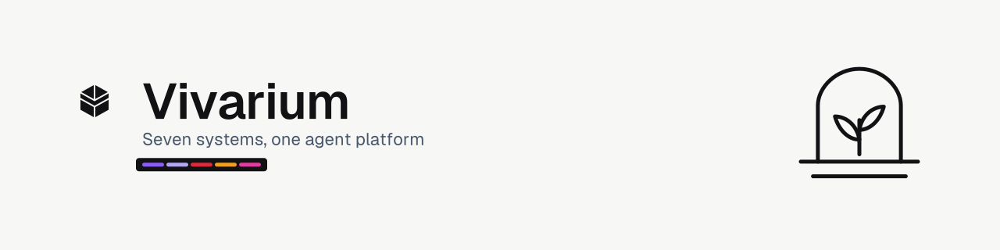
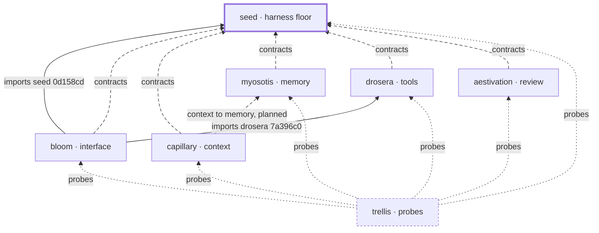

<picture>
  <source media="(prefers-color-scheme: dark)" srcset=".github/assets/vivarium-banner-dark.svg">
  
</picture>

# Vivarium

Seven systems, one agent platform.

Vivarium is a personal agent platform. A person raises an assistant with a character and a job, gives it memory they consent to keep, and works alongside it: it reads what they point it at, asks before it acts outside its bounds, and leaves a record of what it did. It runs on the person's own machine first, and every route it takes to a model, a file, or a service is one the person switched on.

This repository is the umbrella, not the product. It pins the seven systems at exact commits, records what each one owns, and gives a code agent the context it needs to work in the family without guessing. No product code lives here: the code lives in the seven repositories, and this tree is the one snapshot that says which code that is.

bloom is Vivarium's user interface; the other six systems are the parts behind it.

## The systems

| System | Role | Layer |
| --- | --- | --- |
| [seed](https://github.com/Vidoxlabs/seed) | Harness floor: run records, tool identity, provider adapters, the shared contracts | floor |
| [capillary](https://github.com/Vidoxlabs/capillary) | Context: bounded retrieval with sources attached, and relations | peer |
| [myosotis](https://github.com/Vidoxlabs/myosotis) | Memory: consent to keep, structural forget | peer |
| [drosera](https://github.com/Vidoxlabs/drosera) | Tools: tool faces, skills, hooks, cookbooks | peer |
| [aestivation](https://github.com/Vidoxlabs/aestivation) | Review and delegation: plans, verdicts, questions to the person, the assembly gate | peer |
| [bloom](https://github.com/Vidoxlabs/bloom) | User interface: the desktop and web app, first-run setup, the head agent; the only composer | composer |
| [trellis](https://github.com/Vidoxlabs/trellis) | Testing from outside the call path: shape, behavior, consistency, operational probes | outside |

The floor holds the contracts. The four peers do not import each other; they meet at seed. bloom is the only composer: it is where a person raises an agent and where the parts are put together. trellis tests from outside the call path, so a failure in the tree is not a failure the tree can hide.

## System map

<!-- vivarium:map:start -->


Solid is an import today, labelled with the pinned short SHA. Dashed is a contract. Dotted is a probe from outside the call path. Edges marked planned are not built yet.
<!-- vivarium:map:end -->

## Status

<!-- vivarium:status:start -->
| System | Pin | Version | CI |
| --- | --- | --- | --- |
| seed | [0d158cd](https://github.com/Vidoxlabs/seed/commit/0d158cd7e1fb5098162c98d303ddde8172001062) | 0.10.0 | [](https://github.com/Vidoxlabs/seed/actions/workflows/ci.yml) |
| capillary | [0caa855](https://github.com/Vidoxlabs/capillary/commit/0caa855cca2780f29d1d11167f4f352ba28ee9f5) | 1.3.0 | [](https://github.com/Vidoxlabs/capillary/actions/workflows/ci.yml) |
| myosotis | [4c7a8b8](https://github.com/Vidoxlabs/myosotis/commit/4c7a8b8ef632c8b36a2f92d9be6d1cefdcf10db9) | 1.2.0 | [](https://github.com/Vidoxlabs/myosotis/actions/workflows/ci.yml) |
| drosera | [34c5c29](https://github.com/Vidoxlabs/drosera/commit/34c5c29c15f1d1f8baa6de6d5016f4809d68f098) | 2.4.0 | [](https://github.com/Vidoxlabs/drosera/actions/workflows/ci.yml) |
| aestivation | [f506c9e](https://github.com/Vidoxlabs/aestivation/commit/f506c9e9a25017ea354e68861ce9112e90d73374) | 0.5.0 | [](https://github.com/Vidoxlabs/aestivation/actions/workflows/ci.yml) |
| bloom | [4e61cca](https://github.com/Vidoxlabs/bloom/commit/4e61cca4ec1d158cd592afcd56a3280489aceedf) | 0.12.0 | [](https://github.com/Vidoxlabs/bloom/actions/workflows/check.yml) |
| trellis | [76d59fb](https://github.com/Vidoxlabs/trellis/commit/76d59fb1edb6b7093ae8a42ca29e4bfbd524f5e1) | 0.8.0 | [](https://github.com/Vidoxlabs/trellis/actions/workflows/ci.yml) |
<!-- vivarium:status:end -->

## Quick start

```bash
git clone --recurse-submodules https://github.com/Vidoxlabs/vivarium.git
cd vivarium
npm run check
npm run sync   # move every system to the latest main and regenerate the manifest
```

Already cloned it without the systems? Run `git submodule update --init --recursive`.

`npm run check` is offline and deterministic. It fails when a generated file drifts from the pins, when a submodule is not at its gitlink, when a relative link or a `systems/` path does not resolve, or when a public-safety rule trips. `npm test` runs the unit tests for the tool itself.

## How changes flow

1. **Change a system in its own repository.** A pull request there, its own tests, its own review. Nothing in this repository edits a submodule.
2. **The pin moves here.** Either the scheduled bump opens a pull request with the new pins and the regenerated manifest and map, or a person runs `npm run sync` and opens `chore(systems): bump <names>`. Either way the pin is a commit that is on that system's `main`.
3. **Readers get the prose from the docs hub.** [docs](https://github.com/Vidoxlabs/docs) syncs every system's README and documentation, so this repository links to those pages instead of copying them.
4. **`docs` is linked, not pinned.** It is product-neutral and may serve more than one product, so it is not part of the snapshot. Neither is [videsign](https://github.com/Vidoxlabs/videsign), the design canon this repository's banner follows.

## Links

| Where | What it is |
| --- | --- |
| [docs](https://github.com/Vidoxlabs/docs) | The documentation hub, with every system's documentation synced |
| [videsign](https://github.com/Vidoxlabs/videsign) | The design canon, including the family banner system |
| [docs/system-map.md](docs/system-map.md) | The generated map and the full pin table |
| [AGENTS.md](AGENTS.md) | The context file a code agent reads before touching the tree |
| [docs/product/](docs/product/) | The product specs: naming, first-run setup, model access, context access |
| [templates/agent-setup/](templates/agent-setup/) | The agent schema, the setup script, and three generic example agents |
| [docs/vision/design-brief.md](docs/vision/design-brief.md) | The living product brief: direction, not claims |
| [docs/adr/](docs/adr/) | The decision records, from the umbrella layout to the web app's context routes |

## License

This software is licensed under the MIT License. See [LICENSE](LICENSE).
The Vidoxlabs name and mark are trademarks of Vidoxlabs LLC. They are not covered by this repository's MIT license.
