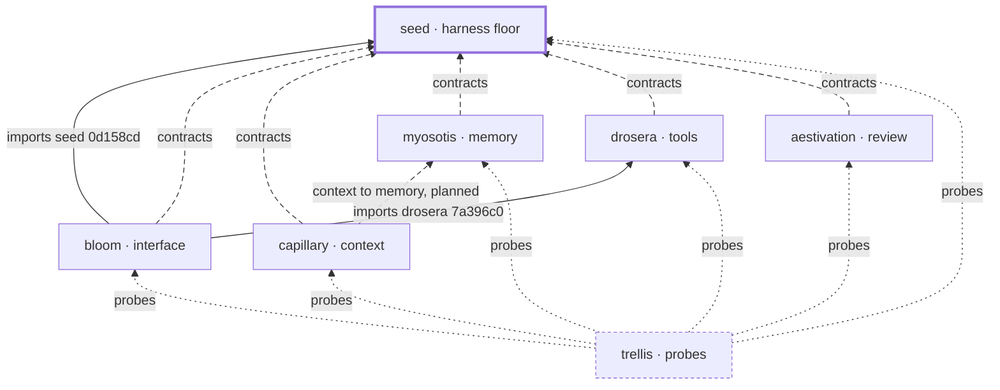

# System map

Generated by `npm run map` from `vivarium.json`. Edit `systems.config.json` or the pinned
commits, then run `npm run sync`. Do not edit this file by hand.

## The tree

Solid is an import today, labelled with the pinned short SHA. Dashed is a contract. Dotted is a probe from outside the call path. Edges marked planned are not built yet.

## Pins

| System | Layer | Role | Pin | Version |
| --- | --- | --- | --- | --- |
| [seed](https://github.com/Vidoxlabs/seed) | floor | Harness floor: run records, tool identity, provider adapters, the shared contracts | [0d158cd](https://github.com/Vidoxlabs/seed/commit/0d158cd7e1fb5098162c98d303ddde8172001062) | 0.10.0 |
| [capillary](https://github.com/Vidoxlabs/capillary) | peer | Context: bounded retrieval with sources attached, and relations | [0caa855](https://github.com/Vidoxlabs/capillary/commit/0caa855cca2780f29d1d11167f4f352ba28ee9f5) | 1.3.0 |
| [myosotis](https://github.com/Vidoxlabs/myosotis) | peer | Memory: consent to keep, structural forget | [4c7a8b8](https://github.com/Vidoxlabs/myosotis/commit/4c7a8b8ef632c8b36a2f92d9be6d1cefdcf10db9) | 1.2.0 |
| [drosera](https://github.com/Vidoxlabs/drosera) | peer | Tools: tool faces, skills, hooks, cookbooks | [34c5c29](https://github.com/Vidoxlabs/drosera/commit/34c5c29c15f1d1f8baa6de6d5016f4809d68f098) | 2.4.0 |
| [aestivation](https://github.com/Vidoxlabs/aestivation) | peer | Review and delegation: plans, verdicts, questions to the person, the assembly gate | [f506c9e](https://github.com/Vidoxlabs/aestivation/commit/f506c9e9a25017ea354e68861ce9112e90d73374) | 0.5.0 |
| [bloom](https://github.com/Vidoxlabs/bloom) | composer | User interface: the desktop and web app, first-run setup, the head agent; the only composer | [4e61cca](https://github.com/Vidoxlabs/bloom/commit/4e61cca4ec1d158cd592afcd56a3280489aceedf) | 0.12.0 |
| [trellis](https://github.com/Vidoxlabs/trellis) | outside | Testing from outside the call path: shape, behavior, consistency, operational probes | [76d59fb](https://github.com/Vidoxlabs/trellis/commit/76d59fb1edb6b7093ae8a42ca29e4bfbd524f5e1) | 0.8.0 |
