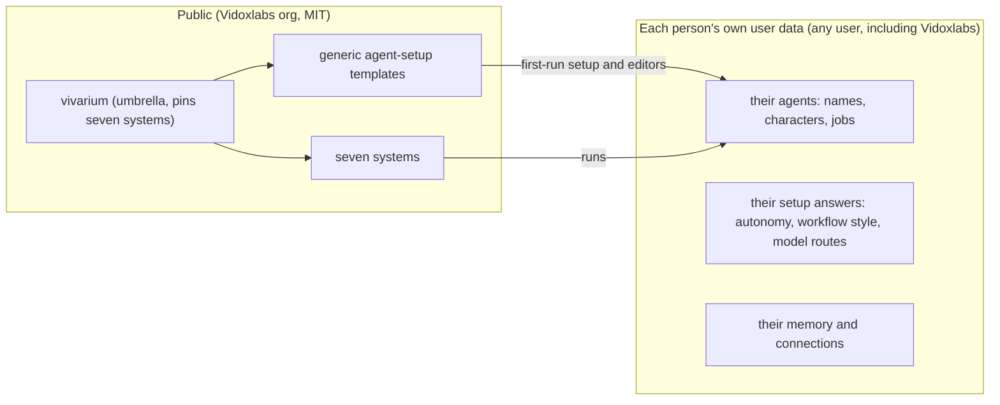

# Vivarium design brief

Living document. Edit by PR; record changes in docs-timeline.md.

- Status: living document, second edition (owner decisions of 25 November 2026 folded in)
- Date: 25 November 2026
- Scope: the Vivarium umbrella over seven public systems: `seed`, `bloom`, `capillary`, `myosotis`, `drosera`, `aestivation`, and `trellis`
- Audience: the owner, contributors, and the code agents that build Vivarium

Market figures and vendor policies below were read on 25 November 2026 from the sources in section 9. They move month to month. Re-check them before quoting them anywhere public.

### Owner decisions in this edition (25 November 2026)

1. **One setup path for everyone.** There is no private overlay. Vidoxlabs' own internal agents are created in the app through the same first-run setup and editors any user goes through, so the team uses the product exactly as users do (section 2.5).
2. **Model access at launch:** the person's existing subscriptions where the provider officially supports sign-in from other apps, their own API keys, and local or on-device models. No hosted plan and no broker at launch; hosted credits are "later, maybe" (section 3.4).
3. **Platforms:** desktop app and a cloud-hosted web app first; mobile later. The web app reaches device context through an optional paired companion and other opt-in routes (section 5.5).
4. **No default autonomy level.** A scripted first-run setup has the person choose autonomy and simple or advanced workflows, and shows where to change both later (section 2.4a).
5. **Vivarium is the public product name.** `bloom` is Vivarium's user-interface system, not the product (section 1).
6. **`docs` is not pinned by the umbrella.** It is product-neutral, may serve future products, and already syncs every system's documentation; Vivarium links to it and does not duplicate it (section 8).

---

## 1. What Vivarium is

Vivarium is the public product name and the umbrella for one product idea: **a personal agent platform where people raise personified assistants that remember them, learn their work, and act with them and for them.** The seven systems are the organs of that platform:

| System | Role in Vivarium | Question it answers |
| --- | --- | --- |
| `seed` | Harness floor: run records, tool identity, provider adapters, the contracts everything else speaks | "What is a run, a tool, a provider, a budget?" |
| `bloom` | User interface: the desktop and web app a person opens, the first-run setup, the head agent, the workspace the agent and person share | "Where do I set up my agents, talk to them, and watch them work?" |
| `capillary` | Context: bounded retrieval with sources attached, and the relations between things | "What does the agent need to know right now, and where did it come from?" |
| `myosotis` | Memory: consent to keep, structural forget | "What does the agent remember about me and itself, and who allowed it?" |
| `drosera` | Tools: tool faces, skills, hooks, cookbooks | "What can the agent do, and how does it find the right tool?" |
| `aestivation` | Review and delegation: plans, verdicts, questions to the person, the assembly gate | "Should this step run, who does it, and what do we ask the person first?" |
| `trellis` | Testing from outside the call path: shape, behavior, consistency, operational probes | "Does it actually work, and did it stay working?" |

The umbrella repository pins all seven by commit, so a person or a code agent sees one coherent snapshot of the platform instead of seven moving targets.

**Naming.** People use *Vivarium*; *bloom* is the part of Vivarium they see and touch. Write "Vivarium" for the product and "bloom" only for the interface system. The other six systems are likewise parts of Vivarium, never products of their own in user-facing copy.

### Positioning statement (scope of work)

> **Vivarium gives you agents that work with you and for you.** You create a few personified assistants, each with its own character and job. They keep a memory of you that you control, use the apps and accounts you already have, and handle the work you hand them: code and tools, documents and research, and the everyday errands and conversations in between. You decide how much they do on their own.

What this statement commits to:

1. **Personal before general.** The value is an assistant that knows you and your workflows, not a smarter chatbot. Memory (`myosotis`) and context (`capillary`) are the moat.
2. **Works with what you have.** Your devices, apps, logins, and model subscriptions. Not twenty new integrations.
3. **You set the leash.** Autonomy is a setting, not a surprise.

What it does not commit to: being the best coding agent, the best document analyzer, or the best companion app on day one. Vivarium wins by being the place those jobs meet the same memory and the same assistants.

---

## 2. Focus area 1: agent creation and delegation

### 2.1 The problem

- People differ. Some want to approve every step and edit every workflow. Others want something that just works and never asks a question they cannot answer.
- Vidoxlabs runs its own internal agents on the same architecture. People should be able to see that the product the company uses is the product they get, with no hidden layer. At the same time, the company's own agent names, notes, and goals are personal data and do not belong in public repositories.

### 2.2 Options

| Option | How it works | Tradeoffs |
| --- | --- | --- |
| A. Fixed presets | Ship three or four ready-made assistants; users pick one | Dead simple; no real personalization; weak long-term retention |
| B. Full builder only | Users define personas, tools, triggers, and policies from scratch | Maximum control; most people never finish setup |
| C. One agent model, two editors | Every agent is the same data object (persona, memory scope, tool grants, autonomy level, workflows). A simple editor creates it by conversation; an advanced editor exposes every field | One code path; users can graduate from simple to advanced without migrating; needs careful defaults |

### 2.3 Autonomy levels

Autonomy is a deliberate design choice, separate from model capability and tool access. Research on agent autonomy levels describes a ladder from the person as operator, through collaborator, consultant, and approver, to observer ([Feng, McDonald, and Zhang](https://arxiv.org/abs/2506.12469)). Vivarium adopts a five-step version in its own terms and pairs it with **action classes**, so a level never means "anything goes":

| Level | Name in the product | The agent... | Often suits |
| --- | --- | --- | --- |
| 1 | Ask me first | proposes every step; the person runs or approves each one | people trying a new agent or a new kind of task |
| 2 | Work alongside | plans with the person, does reversible steps, hands back on anything else | advanced users who like control |
| 3 | Check in | leads the work, asks only when a preference or a fact is missing | people who want progress with occasional questions |
| 4 | Handle it | acts on its own except blockers, credentials, spending, and consequential actions | trusted, well-tested workflows |
| 5 | Run in the background | acts on its own within budgets and standing rules; the person reads the journal and can stop it at any time | scheduled, well-tested routines |

| Action class | Examples | Level 1-2 | Level 3 | Level 4 | Level 5 |
| --- | --- | --- | --- | --- | --- |
| Read | read a file, search, summarize | ask / auto | auto | auto | auto |
| Reversible write | draft, branch, local edit with undo | ask | auto | auto | auto |
| External or irreversible | send, post, submit, delete, merge, deploy | ask | ask | ask | standing rule only |
| Spend | purchase, paid API beyond budget | ask | ask | ask | within a set budget only |
| Credential | sign in, share a secret, grant access | ask | ask | ask | ask |

A **standing rule** is a written permission for one exact action and scope ("send the Friday status email to this list"), created by the person, visible in settings, and revocable. Credentials always ask.

**There is no default level.** Vivarium never preselects one. The person chooses during first-run setup (section 2.4a) and can change it at any time, for all agents or per agent.

### 2.4 Simple and advanced workflows

- **One representation.** A workflow is a plan graph that `aestivation` already knows how to validate: trigger, steps, tool grants, checks, and the questions to ask the person.
- **Simple editor.** The person describes the job in words ("every Monday, read my inbox for invoices and put them in a sheet"). The agent drafts the plan, shows it as a short checklist, runs it once while the person watches, and saves it.
- **Advanced editor.** The same plan as an editable graph or text file, with triggers, budgets, per-step autonomy overrides, and `trellis` tests attached.
- **Graduation.** Any simple workflow opens in the advanced editor; nothing is converted or lost.

### 2.4a First-run setup (scripted, on first app start)

Why: people rarely look for a setting they do not know exists. If an agent stops to ask a question the person never chose, they conclude the app is broken. If they chose "ask me first" themselves and the question says so, they know it is a setting and where to change it. Setup makes every behavior that shapes the experience a choice the person made.

The script, in order (each screen has a plain-language explanation, an example, and "you can change this later in Settings"):

| Step | The person chooses | Notes |
| --- | --- | --- |
| 1. Welcome | nothing | What Vivarium is in two sentences; how long setup takes; that every answer can be changed later |
| 2. Model access | one or more routes: an existing subscription (official sign-in programs only), an API key, or a local model | Shows who bills them for each route (their provider, never Vidoxlabs). A route is needed before an agent can run; setup can continue without one and says what will not work yet |
| 3. Workflow style | Simple or Advanced | Simple: describe jobs in words, see a checklist. Advanced: the full plan editor. Switchable any time; nothing is lost (2.4) |
| 4. Autonomy | a level from 1 to 5, with **no option preselected** | Each level shows the action-class row it implies and one worked example ("you ask for a weekly report: at this level the agent..."). Credentials always ask at every level, and the screen says so |
| 5. Questions | where questions arrive (in-app inbox, notifications, batched digest) and quiet hours | Sets expectations for how often the person will be asked, given step 4 |
| 6. Context access | optional sources: the companion app, a browser extension, account connectors, file upload | Each is off until chosen; each shows what it can and cannot read (5.5) |
| 7. First agent | start from a template or from a blank agent; name, character, job | Simple style creates it by conversation; Advanced shows every field |
| 8. Summary | confirm | One screen restating every choice, with the exact place to change each: Settings, then Autonomy (global) and Agent, then Autonomy (per agent) |

Rules that keep setup honest:
- Setup answers are stored as the agent definition and the autonomy policy record (`seed` contracts), not as UI state, so every system reads the same choice.
- Every question an agent asks because of the chosen level carries a short line: "You set this agent to *Check in*. Change" linking to the setting.
- Setup can be re-run from Settings at any time; re-running never deletes agents or memory.
- `trellis` tests that no autonomy option is preselected, that every question card links to its setting, and that the summary matches what was stored.

### 2.5 Internal agents use the same setup as everyone

The rule: **there is no private layer.** Vidoxlabs' internal agents are ordinary user-created agents. The owner creates them in the app, through the same first-run setup, editors, templates, and settings any user has, and the team uses the product the way users do.

- **Public core.** `vivarium` and the seven systems ship the app, the setup script, and **generic** agent templates (for example a planner, a builder, a researcher). They never ship anyone's personal agents.
- **Personal agents stay personal.** Agents a person creates, including Vidoxlabs' own, live in that person's local user data (or their own encrypted account data in the web app), never in a repository.
- **Same path, same fixes.** If an internal agent needs something the setup or editors cannot express, that is a missing feature for every user and is built in public. There is no private patch, fork, or overlay.
- **Guards.** Public CI rejects forbidden strings (stored as hashes, so the list itself reveals nothing) and operational detail, so personal names and private details never land in public files.
- **Dogfooding.** The owner configures the team through the same steps a new user takes, so friction the owner feels is friction users feel, and it gets fixed for both.

### 2.6 Recommendation

Option C, with no default autonomy level (the person chooses in first-run setup, 2.4a), the action-class table as the policy contract, and internal agents created through the same setup as every user's (2.5).

| Piece | Owner system |
| --- | --- |
| Agent definition, setup answers, and autonomy policy record (contract) | `seed` |
| Plan graph, per-step admission, questions to the person, delegation to specialist agents | `aestivation` |
| First-run setup, agent creator, simple and advanced editors, autonomy setting, questions inbox | `bloom` |
| Per-agent memory scope and consent | `myosotis` |
| Tool grants per agent | `drosera` |
| Autonomy-policy conformance tests (an agent at level N never takes a class it may not) | `trellis` |

---

## 3. Focus area 2: affordable model access

### 3.1 The problem

Agents burn tokens. People who cannot run models locally and do not want another subscription or an API bill will not adopt a product whose every task costs money they did not plan for. Many target users already pay for a chat or coding subscription and expect to reuse it.

### 3.2 What the market allows today

| Route | Status on 25 Nov 2026 | Tradeoffs |
| --- | --- | --- |
| Bring your own API key (any provider) | Universally allowed; usage billed to the key owner | Cheapest for Vidoxlabs; friction for non-technical users; surprise bills without budgets |
| Bring your own ChatGPT plan | OpenAI's "Sign in with ChatGPT" lets Go, Plus, Pro, and Business users spend their plan allowance in participating apps. Terms require requests to come from the user's own local runtime or a runtime only they control, tokens stored locally, no charge to use the plan, and plan use only inside the connected app ([terms](https://openai.com/policies/sign-in-with-chatgpt-terms/), [help](https://help.openai.com/en/articles/20001542-using-your-chatgpt-plan-in-other-apps-and-sites)) | Zero extra cost for many users; tied to one vendor's program, participation rules, and plan limits. Because the terms require the user's own local runtime, Vivarium's web app uses this route only through the user's desktop app or paired companion (5.5), never from Vidoxlabs servers |
| Bring your own Claude plan | Not permitted: Anthropic reserves consumer-plan OAuth for its own apps and forbids third parties from routing requests through Free, Pro, Max, or Ultra credentials ([legal and compliance](https://code.claude.com/docs/en/legal-and-compliance)). An unmodified Claude Code binary signed in by the user is allowed | Use API keys or cloud-provider credentials for Claude; or drive the user's own unmodified Claude Code install as a tool |
| Free tiers | Gemini API free tier around 20 requests per day per project on Flash models; OpenRouter free variants around 50 requests per day (1,000 after a credit purchase) ([Gemini limits](https://ai.google.dev/gemini-api/docs/rate-limits), [OpenRouter limits](https://openrouter.ai/docs/api_reference/limits)) | Fine for a trial and for triage; far too small for real agent work |
| On-device models | Apple's Foundation Models framework gives free, offline inference on Apple Intelligence devices; Android's ML Kit Prompt API runs Gemini Nano locally on supported phones ([Apple](https://developer.apple.com/foundation-models-framework/), [Android](https://developer.android.com/blog/posts/build-intelligent-android-apps-on-device-inference)) | Free and private; small models; good for routing, summarizing, classifying, and drafting, not for long agent runs |
| Local desktop models | Local model runtimes on a capable PC or Mac | Free per token; hardware-bound; quality gap on long tool-using runs |
| Vidoxlabs-hosted credits or a broker | Vidoxlabs buys tokens and resells metered usage, or routes through a third-party broker | Simplest for users, but asks people to trust a new company with their prompts and their spend before it has earned that trust; margin and abuse risk sit with Vidoxlabs. Not at launch |

### 3.3 Cost levers that work regardless of route

| Lever | Evidence | Where it lives |
| --- | --- | --- |
| **Model ladder and routing**: a small or on-device model triages and handles easy steps; a frontier model only for hard steps | Published router evaluations report roughly 40-70% cost savings at 97-98% of strong-model quality, and a 2026 hybrid router reports 54% savings within 0.3 points of the strong baseline. Savings depend on traffic mix, and misrouted hard prompts hurt quality ([HyDRA](https://arxiv.org/html/2605.17106), [TrueFoundry benchmark](https://www.truefoundry.com/blog/engineering/llm-cost-routing-benchmark/)) | `seed` provider adapters and budget record; `aestivation` decides per step |
| **Prompt caching**: stable system prompt, persona, and tool index first, volatile content last | Cached input is billed at about one tenth of fresh input on current OpenAI list prices ([OpenAI pricing](https://developers.openai.com/api/docs/pricing)) | `seed` request shape; `capillary` packet ordering |
| **Batch for background work** | Batch processing is listed at half the standard price ([OpenAI pricing](https://developers.openai.com/api/docs/pricing?pricing=batch)) | `aestivation` marks steps that can wait |
| **Context discipline**: bounded packets, summaries, references instead of copies | Fewer input tokens on every turn | `capillary`, `myosotis` |
| **Tool search instead of tool dumps** | Loading tools on demand cut one reported setup from about 77K to 8.7K context tokens while raising tool-selection accuracy ([Anthropic](https://www.anthropic.com/research/advanced-tool-use), [MCP client guidance](https://modelcontextprotocol.io/docs/2025-11-25/develop/clients/client-best-practices)) | `drosera` |
| **Budgets with hard caps** | Prevents surprise bills and runaway loops | `seed` budget record; `bloom` shows spend live |

### 3.4 Recommendation

1. **Launch provider-neutral, with three routes the person already controls:** an existing subscription through an official sign-in program (today, "Sign in with ChatGPT" where the program allows it), their own API key from any provider, and local or on-device models. Present them in plain words ("Use my plan", "Use my own key", "Run on this device"). Vidoxlabs never bills for model use at launch, and never handles consumer-plan credentials outside the vendor's own flow.
2. **Ship the model ladder by default:** on-device or small cloud model for triage, chat, and summaries; a mid-tier model for most tool steps; a frontier model only when `aestivation` marks a step as hard or a check fails.
3. **Every agent has a monthly budget** with a hard cap and a visible meter. Level 5 agents cannot exceed it.
4. **Hosted credits: later, maybe.** No hosted plan and no broker at launch: early users want low cost or free, and asking them to route prompts and money through a new company raises the trust question before the product has answered it. Revisit only once there are users who ask for one bill, priced at cost plus a stated margin.
   - **Keys stay with the person.** In the desktop app, API keys live in the operating system's credential store. In the web app, keys are kept on the paired companion by default; storing a key in the web account is an explicit opt-in, encrypted, with the trade-off explained.
5. **Measure cost per finished task** in `trellis` operational probes, so a change that doubles token use fails CI.

Owners: `seed` (provider adapters, model ladder, budget contract), `capillary` (packet size and cache-friendly ordering), `drosera` (tool search), `aestivation` (per-step model choice, batching), `bloom` (provider sign-in and spend meter), `trellis` (cost regression probes).

---

## 4. Focus area 3: scope of work

### 4.1 The problem

People use agents for three broad jobs: building code and tools; work such as reading PDFs, research, and reports; and everyday conversation and errands. Building three products dilutes the effort. Building one generic chat box produces a lesser product that the next model release makes obsolete.

### 4.2 Options

| Option | Tradeoffs |
| --- | --- |
| A. Pick one vertical (for example coding) | Clear story; crowded market; leaves the personal-assistant thesis unproven |
| B. Generic assistant | Broad; nothing a frontier vendor's own app does not do better |
| C. Personal core plus installable skill packs | The core (persona, memory, context, tools, review, autonomy) is shared; each job is a pack of skills, tools, workflows, and tests. Needs a strong pack format and good starter packs |

### 4.3 Recommendation

Option C. Build the layer that gets **more** valuable as models improve, not less:

- **Owned by the user, compounding over time:** memory of the person, each assistant's own memory of itself, workflows, and standing rules. These survive model changes and are exportable.
- **Model-agnostic:** a better model is an upgrade for Vivarium, not a replacement for it.
- **Three starter packs at launch,** each with acceptance tests in `trellis`:
  1. *Build:* code and tool work in a real work tree, with plans reviewed by `aestivation`.
  2. *Work:* documents, PDFs, research, and reports, with every claim tied to a source by `capillary`.
  3. *Everyday:* conversation, reminders, errands, and messages, with memory governed by `myosotis`.
- **One assistant can hold several packs.** The person does not choose a product; they give their assistant a new skill.

Owners: `drosera` (pack format: skills, tools, hooks, cookbooks), `seed` (pack and agent contracts), `myosotis` and `capillary` (the compounding layer), `trellis` (per-pack acceptance tests), `bloom` (pack install and discovery).

---

## 5. Focus area 4: connectors and tooling

### 5.1 The problem

Every API or tool-server connector needs its own sign-in, keys, or OAuth grant. Tokens expire, updates break them, tool definitions flood the context window, and agents pick the wrong tool when two look alike. Managing twenty connectors is a chore nobody signs up for. The owner's working theory: let the agent use a computer the way a person does, either the person's own device or a computer of its own.

### 5.2 State of the art (25 Nov 2026)

- **Computer use is now credible.** Leading agents report scores above the original human baseline on the verified OSWorld desktop benchmark, with top submissions reported near 90% against a 72% human baseline measured on the earlier task set ([OSWorld-Verified](https://www.llmboard.ai/benchmarks/osworld-verified-485)). It is still slower and costlier per step than a direct API call, and benchmark tasks are not the long tail of real apps.
- **Operating systems are building the "agent's own seat".** Windows 11's agent workspace gives each agent its own account and its own Windows session, running in parallel with the person's session, with access only to folders and apps the person shares. It is a preview feature, off by default ([Microsoft](https://support.microsoft.com/en-us/windows/ai/ai-features/experimental-agentic-features), [Windows blog](https://blogs.windows.com/windowsexperience/2025/10/16/securing-ai-agents-on-windows/)). Microsoft also offers full cloud PCs for agents in preview.
- **Phones expose actions, not screens.** Android AppFunctions lets apps publish typed functions that authorized agents can call (Android 16+, experimental), and Apple's App Intents expose app actions to Siri and system intelligence, now open to all developers in a preview ([Android](https://developer.android.com/ai/appfunctions), [Apple](https://developer.apple.com/documentation/appintents)).
- **Browser agents in your logged-in sessions work but are attackable.** Researchers demonstrated zero-click prompt-injection attacks against browser agents acting inside signed-in sessions; vendors add classifiers and approvals but say the risk is not zero ([SecurityWeek](https://www.securityweek.com/zero-click-ai-browser-hacking-claude-and-chatgpt-atlas-hijacked-via-emails-x-posts/), [Claude help](https://support.claude.com/en/articles/12902428-use-claude-in-chrome-safely)).
- **Credentials can be filled without the model seeing them.** Password managers now let an agent request a login, the person approves, and the extension fills it outside the model's view ([1Password](https://support.1password.com/1password-for-agents/)).
- **Tool-server auth is maturing.** The current tool-protocol spec requires OAuth 2.1 with short-lived tokens and adds enterprise-managed authorization ([spec](https://modelcontextprotocol.io/specification/2025-11-25/basic/authorization)). It reduces the mess; it does not remove one sign-in per service.

### 5.3 The two device models, honestly

| | Agent drives the person's device | Agent has its own computer |
| --- | --- | --- |
| Context and logins | Everything is already there | Starts empty; needs files and sign-ins shared into it |
| Contention | Person and agent fight over one mouse, keyboard, and focus | None; both work at once |
| Safety | Mistakes land on the person's real session | Mistakes land in a sandbox first |
| Supervision | Person sees everything, but only while watching | Needs a journal and a live view |
| Redundant storage | None | Risk of copied files and stale duplicates |
| Cost | Free | A second machine or a cloud PC |

### 5.4 Recommendation: "a seat beside you"

Neither extreme. Give the agent **its own seat on the person's machine**: a separate session or profile on the same device, sharing what the person chooses, plus an optional cloud seat for always-on work.

1. **Own seat, shared context.** The agent works in its own desktop session, browser profile, and working folders on the person's device. It reads the person's files by reference through `capillary` (pointer plus digest, not copies), so there is one source of truth and no stale duplicates. Where the OS offers an agent workspace (Windows today), use it; elsewhere, use a separate user profile or a contained virtual desktop.
2. **An access ladder instead of a connector zoo.** The agent tries the cheapest reliable route first:

   | Rung | Route | Sign-in burden |
   | --- | --- | --- |
   | 0 | Local files, clipboard, and OS-native app actions (App Intents, AppFunctions, Windows agent connectors) | None |
   | 1 | The agent's own browser profile, signed in once by the person; secrets filled by the person's password manager outside the model's view | Once per site, renewed by the browser like any person's session |
   | 2 | API or tool-server connectors only for high-value, high-frequency services, loaded on demand through tool search | One sign-in screen for all of them, with health checks and renewal handled by `drosera` |
   | 3 | Vision-based computer use as the universal fallback for anything else | None beyond rung 1 |

3. **No contention on phones (later).** When mobile arrives, the phone is the remote control, not the workstation: chat, voice, the questions inbox, notifications, and OS-native actions. Long tasks run in the desktop app, the web app, or a companion.
4. **Supervision without staring.** Every action goes to a journal with screenshots for visual steps; reversible actions get undo; external or irreversible actions follow the autonomy table in section 2.3; a live view lets the person watch or take over at any time.
5. **Injection defense by design.** Content the agent reads is data, never instructions; actions triggered while reading untrusted content are held for review by `aestivation`; the browser seat has no access to the password vault except through the approve-and-fill flow.
6. **Optional cloud seat** for 24/7 routines, later, with the same journal and policies.

### 5.5 How the cloud web app gets context without direct device access

A web app running on Vidoxlabs servers cannot see a person's files, apps, or signed-in sessions, and should not pretend to. It gathers context only through routes the person turns on, each visible and revocable, cheapest first:

| Route | What it reaches | How it connects |
| --- | --- | --- |
| Upload and drag-in | Files, screenshots, pasted text the person hands over | The browser; nothing else installed |
| Account connectors | Cloud data the person already keeps online (for example mail, drive, calendar, code hosting) | Standard OAuth grants with the narrowest scopes, loaded on demand through tool search (5.4, rung 2) |
| Browser extension | The page the person is looking at, selections, and tabs they share | Optional extension; reads only on the person's action or for sites they allow |
| The agent's own cloud browser | Public web research and sites the person signs the agent into once | A browser session that belongs to the agent, not to the person's own browser |
| Paired companion | Local files by reference, local apps, the clipboard, local models, and subscription sign-in programs that require a local runtime | The desktop app, or a small companion agent, paired to the web account by a one-time code. It opens an **outbound-only** connection, so no ports are opened on the person's network, and it enforces the same autonomy settings locally |

Device-only steps (a local file, a desktop app, a local model, a plan that must run on the person's own runtime) are handed to the companion. If none is paired, the agent says what it would need and offers the next-best route (upload, a connector), instead of guessing. Web pages and third-party chat sites are never driven from Vidoxlabs servers inside the person's own signed-in sessions.

Owners: `bloom` (pairing UI, route picker in setup), `drosera` (connector broker, companion tool faces), `capillary` (by-reference context with digests from every route), `seed` (session protocol between web app and companion), `aestivation` (holds for actions triggered by untrusted content), `trellis` (pairing and route probes).

Owners: `drosera` (access ladder, tool search, connector broker, OS action adapters), `bloom` (agent seat, live view, takeover, journal UI), `capillary` (by-reference context with digests), `myosotis` (what the agent may keep from what it saw), `aestivation` (action review, injection holds), `seed` (tool identity and action-class contract), `trellis` (probes that replay journals and check policies held).

---

## 6. Focus area 5: interfaces and platforms

### 6.1 Market share (StatCounter, October 2026, share of web page views, not installed base)

| Segment | Share | Source |
| --- | --- | --- |
| Desktop worldwide | Windows 76.6%, macOS 15.7%, Linux 5.7%, ChromeOS 2.0% | [Dr. Windows summary of StatCounter](https://www.drwindows.de/news/browser-und-betriebssysteme-im-oktober-2026) |
| Mobile worldwide | Android 72.4%, iOS 27.6% (12-month average about 69% / 31%) | [Spreadcast summary of StatCounter](https://spreadcast.app/resources/android-vs-ios-market-share) |
| Mobile United States | iOS 52.0%, Android 48.0% (12-month average about 59% iOS) | same |
| All platforms worldwide | Android 44.7%, Windows 28.9%, iOS 17.5%, macOS 5.9%, Linux 2.2% | [Dr. Windows](https://www.drwindows.de/news/browser-und-betriebssysteme-im-oktober-2026) |

Reading: mobile is where people are; the desktop is where agents can do real work today; Windows dominates desktops; iOS leads in the United States; Android leads everywhere else.

### 6.2 Rollout order (decided 25 November 2026)

1. **Desktop app (Windows, macOS, Linux) and a cloud-hosted web app, together.** One interface (`bloom`) in both. The desktop app runs agents on the person's own machine; the web app runs agents in the cloud and reaches the device through the routes in 5.5. Windows gets first-class attention because of its share; macOS because early adopters and developers are there; Linux because it costs little extra.
2. **Companion pairing and browser extension.** The context routes that make the web app useful without device access (5.5).
3. **Messaging channels.** Talk to your assistant from chat apps and email you already use, with the same question and autonomy settings. Low install friction.
4. **Mobile later (iOS and Android).** Chat, voice, the questions inbox, notifications, quick capture, and on-device triage with the phone's own small model. Mobile is harder to build well, so it follows the desktop and web apps.
5. **OS-native integrations.** Publish Vivarium actions through App Intents, AppFunctions, and Windows agent connectors.

Consumer chat sites (for example a vendor's own chat web app) cannot be configured from a hosted web app, and Vivarium does not try. Subscriptions connect only through official sign-in programs (3.2).

Owners: `bloom` (all surfaces), `seed` (one session protocol every surface speaks), `drosera` (OS-native action adapters), `trellis` (cross-platform probes).

---

## 7. Cross-cutting principles

- **Claims match evidence.** Every capability stays labelled `implemented`, `specified`, `planned`, or `observed`, as the systems already require.
- **One change, one repository.** The umbrella pins and explains; it never edits a system. Changes land as pull requests in the owning system.
- **Model-agnostic, device-agnostic, connector-light.** Prefer routes that need no new sign-in.
- **The person stays in charge.** Autonomy is chosen, visible, and revocable; credentials always ask.

## 8. Decisions and open questions

Decided by the owner on 25 November 2026:

| # | Question | Decision |
| --- | --- | --- |
| 1 | Where do the internal agents live? | Nowhere special: they are user-created agents, made through the same in-app setup as any user's, kept in the owner's own user data. No overlay, branch, or fork (2.5) |
| 2 | How do people pay for models at launch? | Existing subscriptions through official sign-in programs, their own API keys, and local models. No hosted plan or broker at launch; hosted credits later, maybe (3.4) |
| 3 | First surface? | Desktop app and cloud-hosted web app; mobile later (6.2) |
| 4 | Default autonomy? | None. Chosen in first-run setup, changeable later, with the setting linked from every question (2.3, 2.4a) |
| 5 | Codename or product name? | Product name: Vivarium. `bloom` is its user-interface system |
| 6 | Should the umbrella also pin `docs` and `videsign`? | No. `docs` stays product-neutral (it may serve future products) and already syncs every system's documentation; `videsign` is design canon. Link both |

Still open:

| # | Question | Options | Recommendation |
| --- | --- | --- | --- |
| 7 | Cloud seat for always-on agents: build or rent? | (a) rent cloud PCs; (b) self-host; (c) defer | (c) until the desktop app and web app ship |
| 8 | Subscription programs beyond ChatGPT? | Track each vendor's program; adopt only official ones | Adopt official programs only; never handle consumer-plan credentials outside the vendor's flow |
| 9 | Companion form | (a) the desktop app doubles as the companion; (b) a separate small companion agent; (c) both | (a) first, so there is one install; (b) later for people who want a minimal footprint |

## 9. Sources (read 25 November 2026)

- Feng, McDonald, Zhang, "Levels of Autonomy for AI Agents": https://arxiv.org/abs/2506.12469
- OpenAI, Sign in with ChatGPT Terms: https://openai.com/policies/sign-in-with-chatgpt-terms/
- OpenAI Help, Using your ChatGPT plan in other apps: https://help.openai.com/en/articles/20001542-using-your-chatgpt-plan-in-other-apps-and-sites
- Anthropic, Claude Code legal and compliance: https://code.claude.com/docs/en/legal-and-compliance
- OpenAI API pricing (standard and batch): https://developers.openai.com/api/docs/pricing
- Gemini API rate limits: https://ai.google.dev/gemini-api/docs/rate-limits
- OpenRouter limits: https://openrouter.ai/docs/api_reference/limits
- Apple Foundation Models framework: https://developer.apple.com/foundation-models-framework/
- Android on-device inference: https://developer.android.com/blog/posts/build-intelligent-android-apps-on-device-inference
- HyDRA hybrid routing (arXiv): https://arxiv.org/html/2605.17106
- TrueFoundry routing benchmark: https://www.truefoundry.com/blog/engineering/llm-cost-routing-benchmark/
- Anthropic, advanced tool use: https://www.anthropic.com/research/advanced-tool-use
- Anthropic, code execution with tool servers: https://www.anthropic.com/research/code-execution-with-mcp
- Model Context Protocol, client best practices: https://modelcontextprotocol.io/docs/2025-11-25/develop/clients/client-best-practices
- Model Context Protocol, authorization: https://modelcontextprotocol.io/specification/2025-11-25/basic/authorization
- OSWorld-Verified leaderboard: https://www.llmboard.ai/benchmarks/osworld-verified-485
- Microsoft, Experimental agentic features: https://support.microsoft.com/en-us/windows/ai/ai-features/experimental-agentic-features
- Windows Experience Blog, Securing AI agents on Windows: https://blogs.windows.com/windowsexperience/2025/10/16/securing-ai-agents-on-windows/
- Android AppFunctions: https://developer.android.com/ai/appfunctions
- Apple App Intents: https://developer.apple.com/documentation/appintents
- SecurityWeek, zero-click AI browser hijacking: https://www.securityweek.com/zero-click-ai-browser-hacking-claude-and-chatgpt-atlas-hijacked-via-emails-x-posts/
- Claude Help, Use Claude in Chrome safely: https://support.claude.com/en/articles/12902428-use-claude-in-chrome-safely
- 1Password, agents sign-in support: https://support.1password.com/1password-for-agents/
- StatCounter October 2026 desktop and overall figures (Dr. Windows): https://www.drwindows.de/news/browser-und-betriebssysteme-im-oktober-2026
- StatCounter October 2026 mobile figures (Spreadcast): https://spreadcast.app/resources/android-vs-ios-market-share
